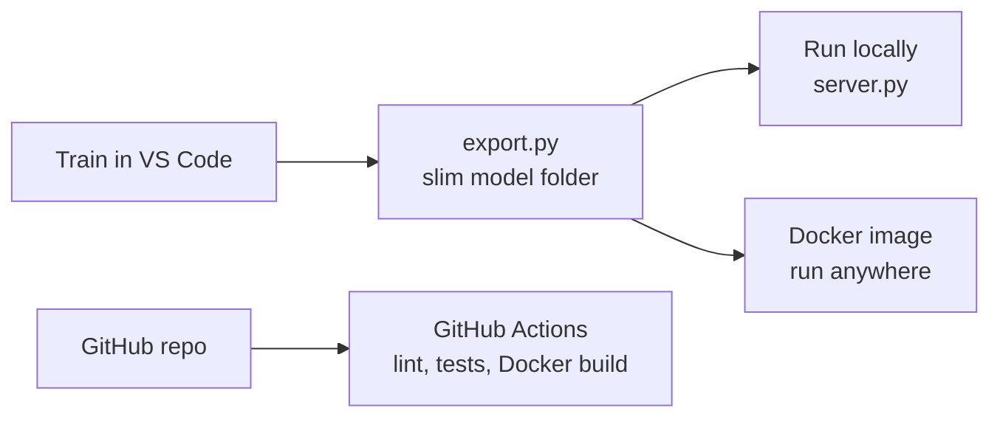

# Running and Deploying Mini-GPT

This guide takes you from training a model to running the web app and REST API on your computer or in a Docker container, and publishing the code on GitHub.



## Architecture of the app

One service (FastAPI + Uvicorn) serves both the web interface and the API:

| Path | What |
|---|---|
| `/` | Gradio web app: Write, Next-token lab, Attention explorer, About & API |
| `/docs` | Interactive API documentation (Swagger UI) |
| `/api/health` | Health check used by Docker and monitoring |
| `/api/model` | Model details and evaluation metrics |
| `/api/generate` | Text generation, JSON response |
| `/api/generate/stream` | Text generation streamed token by token (Server-Sent Events) |
| `/api/next-token` | Top-k next-token probabilities |
| `/api/attention` | Attention weights for a layer |

Production details built in: a KV-cache for fast generation, request validation and limits,
a concurrency limit so a small CPU server isn't overloaded, a request queue in the web app,
request logging, CORS for use from other websites, a Docker health check, and a non-root container user.

---

## Step 1: Train and export

In the VS Code terminal, with the virtual environment activated:

```bash
python prepare.py
python train.py --preset tiny                              # CPU; use --preset small with a GPU
python evaluate.py --run runs/shakespeare_char_tiny        # metrics appear in the app
python export.py --run runs/shakespeare_char_tiny --name "Mini-GPT Shakespeare"
```

This creates `model/` (about 3 MB for the tiny model, about 43 MB for the small one).
If you trained on your own text, add prompts that suit it:
`--examples "Once upon a time" "The king said" --dataset_name "Children's stories"`

## Step 2: Test locally

```bash
pip install -r requirements.txt
python server.py
```

Open http://localhost:7860 for the app (not 0.0.0.0, which browsers can't open) and http://localhost:7860/docs for the API. Try the API:

```bash
curl -X POST http://localhost:7860/api/generate \
  -H "Content-Type: application/json" \
  -d '{"prompt": "ROMEO:", "max_new_tokens": 200, "temperature": 0.8, "seed": 42}'

# streaming, token by token
curl -N -X POST http://localhost:7860/api/generate/stream \
  -H "Content-Type: application/json" -d '{"prompt": "JULIET:", "max_new_tokens": 100}'
```

## Step 3: Put the code on GitHub with CI

```bash
git init && git add . && git commit -m "Mini-GPT: transformer from scratch with deployment"
git branch -M main
git remote add origin https://github.com/Sidrashabir/mini-gpt.git
git push -u origin main
```

GitHub Actions (`.github/workflows/ci.yml`) then runs automatically on every push: linting with Ruff,
all 18 unit tests, a Docker image build and a smoke test that starts the container and calls the API.
A green check mark next to each commit shows that the project builds and all tests pass.

The dataset, training runs and the virtual environment are excluded by `.gitignore`. The small exported
model in `model/` (about 3 MB) is committed, so anyone who clones the repo can run the app immediately.
Larger models can be shared on the Hugging Face Hub instead:

```bash
python export.py --run runs/shakespeare_char_tiny --push_to_hub Sidrashabir/mini-gpt-shakespeare
```

## Optional: run with Docker anywhere

The same image runs on any server or cloud (Render, Railway, Google Cloud Run, AWS, Azure):

```bash
docker build -t mini-gpt .
docker run -p 7860:7860 mini-gpt
```

Settings via environment variables:

| Variable | Default | Purpose |
|---|---|---|
| `MODEL_DIR` | `/app/model` | model folder inside the container |
| `MODEL_REPO` | none | download the model from the Hugging Face Hub instead |
| `MAX_CONCURRENT` | 2 | generations running at the same time |
| `MAX_NEW_TOKENS` | 1000 | upper limit per request |
| `TORCH_THREADS` | all cores | CPU threads for PyTorch |

## Troubleshooting

| Problem | Fix |
|---|---|
| `No model found in 'model'` | Run `export.py` first, or set `MODEL_REPO` |
| Generation feels slow | Lower `MAX_CONCURRENT` to 1, or use `--half` when exporting |
