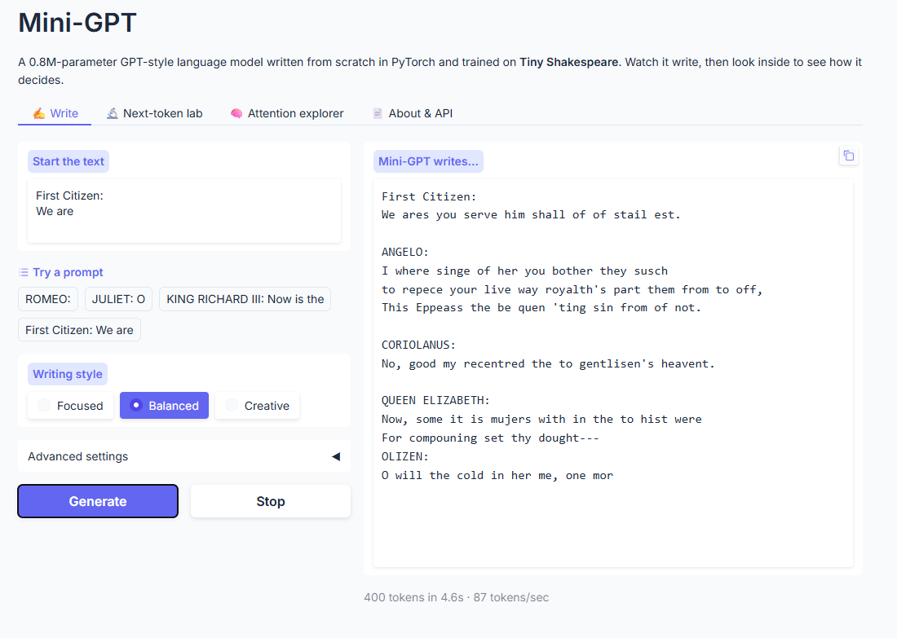
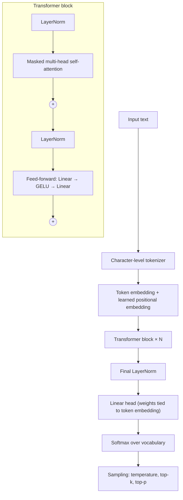
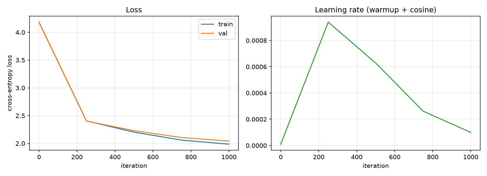
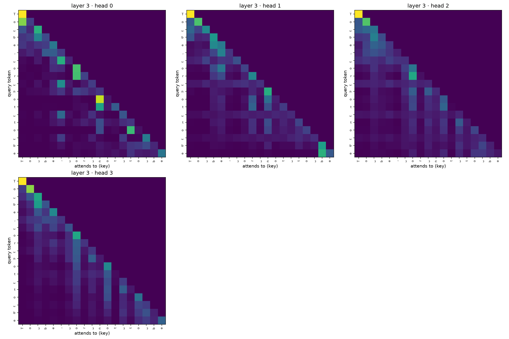
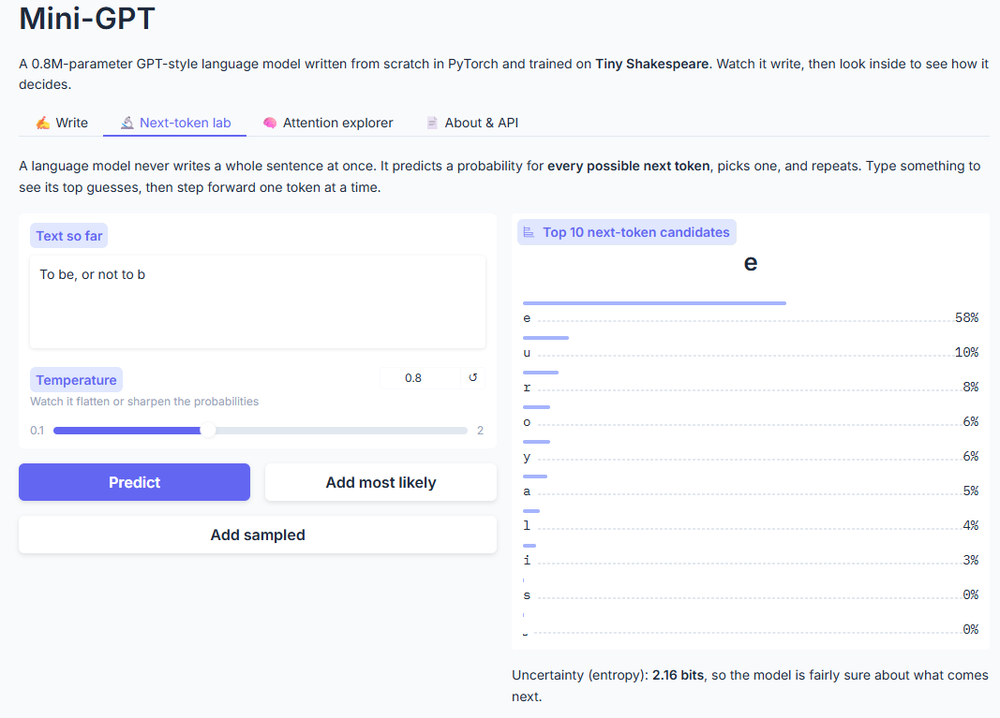
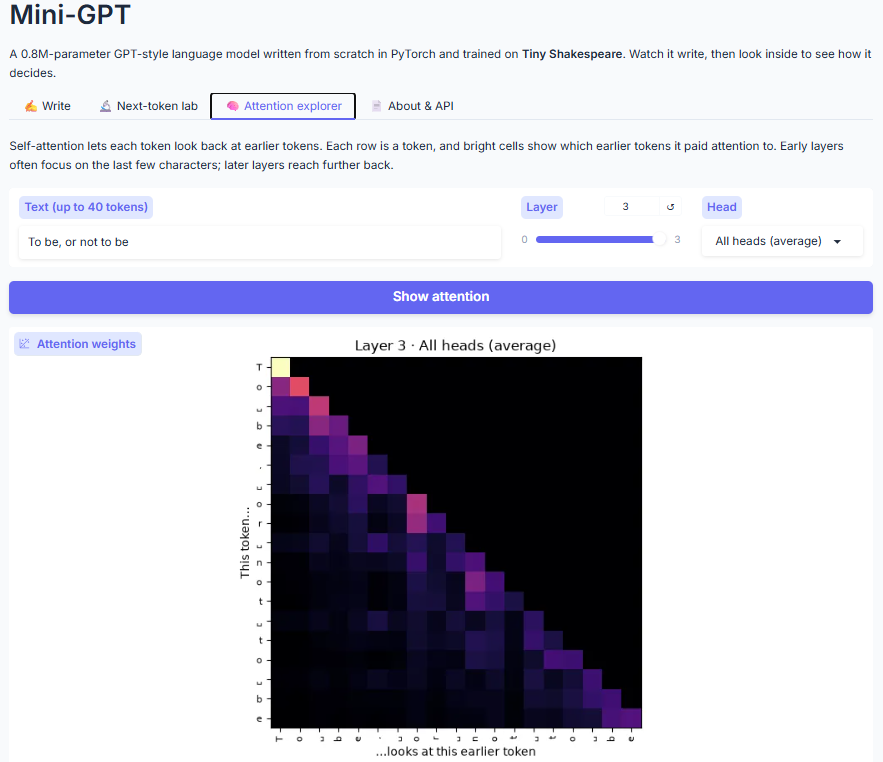
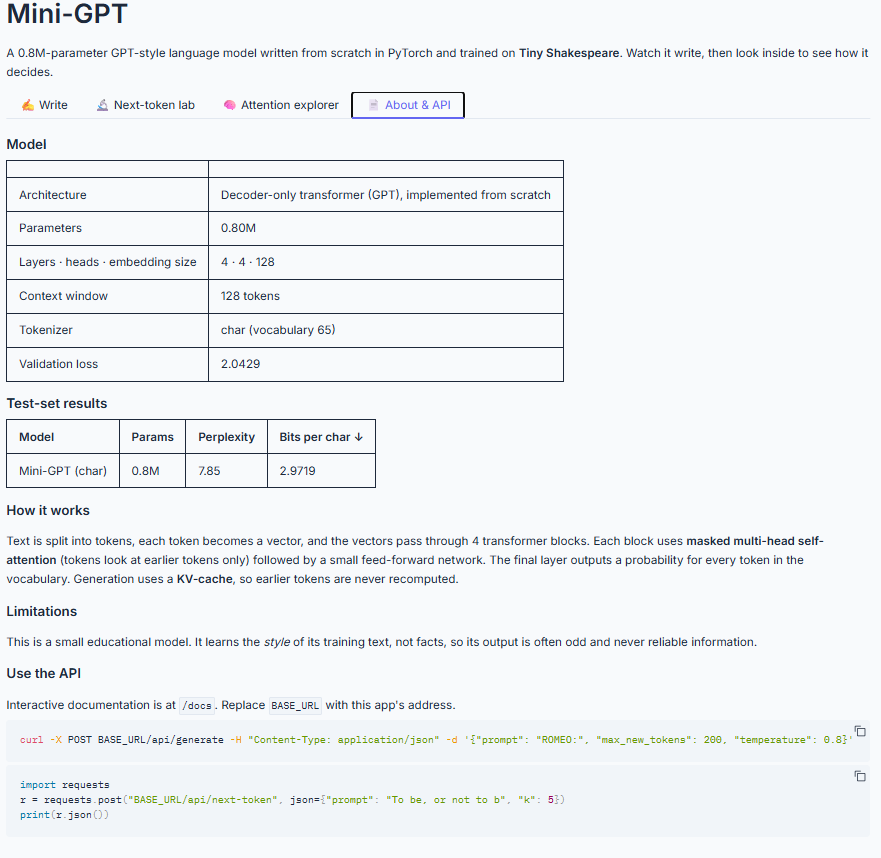

# Mini-GPT: A Transformer Language Model Built From Scratch

[](https://github.com/Sidrashabir/mini-gpt/actions)


A decoder-only transformer, the architecture behind GPT, implemented by hand in PyTorch, trained on the works of Shakespeare, and deployed as a web application with a REST API and interactive interpretability tools.

Every component of the model is written from first principles: multi-head causal self-attention, positional embeddings, pre-LayerNorm residual blocks, weight tying, KV-cache inference and sampling. No `nn.Transformer` or pretrained model classes are used. Correctness is verified by 18 unit tests.

A trained model is included in the repository, so the web app runs immediately after installation (see [Getting started](#getting-started)).



---

## Highlights

- **Transformer from scratch:** scaled dot-product attention, causal masking, multi-head attention, GELU feed-forward layers and GPT-2 style initialization, all implemented manually.
- **Modern training setup:** AdamW with selective weight decay, linear warmup with cosine learning-rate decay, gradient clipping, mixed precision on GPU and best-checkpoint saving.
- **Fair evaluation:** bits-per-character on a held-out test set, a tokenizer-independent metric that allows comparison with OpenAI's pretrained GPT-2.
- **Efficient inference:** a KV-cache that reuses previously computed keys and values, verified by tests to produce outputs identical to full recomputation.
- **Interpretability:** an interactive next-token probability explorer and attention heatmaps for every layer and head.
- **Production deployment:** FastAPI REST API with streaming, request validation and concurrency limits; Docker image; CI pipeline.

---

## Sample output

Generated by the model from the prompt `First Citizen:\nWe are`:

```
First Citizen:
We ares you serve him shall of of stail est.

ANGELO:
I where singe of her you bother they susch
to repece your live way royalth's part them from to off,
This Eppeass the be quen 'ting sin from of not.

CORIOLANUS:
No, good my recentred the to gentlisen's heavent.

QUEEN ELIZABETH:
Now, some it is mujers with in the to hist were
For compouning set thy dought---
```

Working character by character with no built-in knowledge of English words, the model has learned the structure of a play script: speaker names in capitals followed by a colon, verse line breaks, real character names from the plays, punctuation and many correct words. The larger configuration (`--preset small`, 10.6M parameters) produces noticeably more coherent text.

---

## Architecture



| Component | Implementation |
|---|---|
| Causal self-attention | softmax(QKᵀ/√d)·V with a lower-triangular mask, so each token attends only to earlier tokens |
| Multi-head attention | the embedding is split across heads that attend in parallel, then recombined |
| Pre-LayerNorm residual blocks | normalization before each sub-layer for stable training |
| Weight tying | the input embedding and output projection share one matrix |
| Initialization | residual projections scaled by 1/√(2·layers), following GPT-2 |
| KV-cache | keys and values of past tokens are cached during generation |
| Sampling | temperature scaling, top-k and nucleus (top-p) filtering |

### Model configuration

| | Deployed model (`tiny`) | Larger model (`small`) |
|---|---|---|
| Parameters | 0.80M | 10.6M |
| Layers | 4 | 6 |
| Attention heads | 4 | 6 |
| Embedding size | 128 | 384 |
| Context length | 128 characters | 256 characters |
| Vocabulary | 65 characters | 65 characters |
| Training | 1,000 iterations, batch 32, ~10 min on a laptop CPU | 5,000 iterations, batch 64, GPU |

---

## Results

Trained on Tiny Shakespeare (about 1.1M characters), split into 90% training, 5% validation and 5% test as contiguous passages, so the test text is never seen during training.

| Model | Parameters | Test loss | Perplexity | Bits per character ↓ |
|---|---|---|---|---|
| Mini-GPT (tiny, char-level) | 0.80M | 2.060 | 7.85 | 2.972 |

| Metric | Value |
|---|---|
| Best validation loss | 2.043 |
| Loss at initialisation | 4.18 (≈ ln 65, a uniform guess over 65 characters) |
| Training time | 582 seconds on a laptop CPU |

A perplexity of 7.85 means that, on unseen text, the model is on average as uncertain as if it were choosing between about 8 equally likely characters, down from 65 at the start of training. Bits per character is reported because, unlike perplexity, it does not depend on the tokenizer, so it allows a fair comparison with models such as GPT-2 (`python evaluate.py --run runs/shakespeare_char_tiny --compare_hf gpt2`).

### Training curves



Training and validation loss stay close throughout training (1.99 vs 2.04 at the end), indicating that the model generalizes rather than memorizes the training text. The right panel shows the learning-rate schedule, linear warmup followed by cosine decay, sampled at each evaluation step.

### Attention patterns



Each heatmap shows which earlier characters a token attends to in the last layer for the input *"To be, or not to be"* (␣ marks a space). The four heads learn different behaviors, such as focusing on the immediately preceding characters or reaching further back in the sequence.

---

## Web application

| Tab | Description |
|---|---|
| **Write** | Streaming text generation with Focused, Balanced and Creative presets, adjustable sampling parameters and fixed seeds for reproducibility |
| **Next-token lab** | The model's ten most likely next tokens with probabilities and entropy, with step-by-step generation |
| **Attention explorer** | Attention heatmaps for any layer and head |
| **About & API** | Model card, evaluation results and API usage examples |

### Next-token lab



Given *"To be, or not to b"*, the model puts 58% of its probability on **e**, correctly completing "be", with the remaining probability spread over plausible alternatives.

### Attention explorer



### About & API



### REST API

Interactive documentation is served at `/docs`.

| Method | Endpoint | Description |
|---|---|---|
| GET | `/api/health` | Health check |
| GET | `/api/model` | Model configuration and metrics |
| POST | `/api/generate` | Generate a completion (JSON) |
| POST | `/api/generate/stream` | Generate a completion streamed token by token (Server-Sent Events) |
| POST | `/api/next-token` | Top-k next-token probabilities |
| POST | `/api/attention` | Attention weights for a given layer |

```bash
curl -X POST http://localhost:7860/api/generate \
  -H "Content-Type: application/json" \
  -d '{"prompt": "ROMEO:", "max_new_tokens": 200, "temperature": 0.8, "seed": 42}'
```

---

## Getting started

Requirements: Python 3.10 or newer. Developed in VS Code on Windows; also works on macOS and Linux.

```bash
git clone https://github.com/Sidrashabir/mini-gpt.git
cd mini-gpt

python -m venv .venv
.venv\Scripts\activate          # Windows
# source .venv/bin/activate     # macOS / Linux

pip install -r requirements.txt
python -m pytest tests -v       # 18 tests
python server.py                # a trained model is included in model/; open http://localhost:7860
```

### Train, evaluate and run

```bash
python prepare.py                                          # download and tokenize the dataset
python train.py --preset tiny                              # train on CPU (use --preset small with a GPU)
python generate.py --run runs/shakespeare_char_tiny --prompt "ROMEO:"
python evaluate.py --run runs/shakespeare_char_tiny        # add --compare_hf gpt2 for the GPT-2 comparison
python visualize.py --run runs/shakespeare_char_tiny       # training curves and attention plots
python export.py --run runs/shakespeare_char_tiny          # package the model for deployment
python server.py                                           # then open http://localhost:7860
```

To train on a different text, run `python prepare.py --input your_text.txt --name yourdata`, then `python train.py --data data/yourdata_char`.

### Deployment

A single FastAPI service serves both the web interface and the REST API. Besides running it with `python server.py`, it can be run anywhere as a Docker container:

```bash
docker build -t mini-gpt . && docker run -p 7860:7860 mini-gpt
```

See [DEPLOYMENT.md](DEPLOYMENT.md) for the full guide and configuration options.

---

## Project structure

```
mini-gpt/
├── model.py              # transformer implementation
├── tokenizer.py          # character-level and GPT-2 BPE tokenizers
├── prepare.py            # dataset download, tokenization and splitting
├── train.py              # training loop
├── generate.py           # command-line text generation
├── evaluate.py           # test-set metrics and GPT-2 comparison
├── visualize.py          # training curves and attention heatmaps
├── export.py             # package a trained model for the web app
├── model/                # trained model used by the web app (included)
├── inference.py          # inference engine with KV-cache streaming
├── api.py                # REST API endpoints
├── app.py                # web interface
├── server.py             # application entry point
├── Dockerfile
├── assets/               # images used in this README
├── tests/
│   ├── test_model.py     # model correctness tests
│   └── test_serving.py   # inference and API tests
├── .github/workflows/ci.yml
└── DEPLOYMENT.md
```

### Testing

The test suite verifies that changing a future token never affects earlier predictions (no information leakage), that the fused attention kernel matches the manual implementation, that attention weights form valid probability distributions, that the initial loss matches a uniform prediction, that the model can overfit a single batch, that KV-cache inference matches full recomputation, and that the API validates its inputs. Continuous integration runs linting, all tests, a Docker build and a container smoke test on every push.

---

## Future work

- Rotary positional embeddings (RoPE) compared against learned positional embeddings
- A byte-pair encoding tokenizer trained on the dataset itself
- Scaling to a larger corpus such as TinyStories with a 30M-parameter model
- Fine-tuning on a second writing style and measuring how much of the first is retained

---

## References

1. Vaswani, A., et al. (2017). *Attention Is All You Need.* NeurIPS.
2. Radford, A., Wu, J., Child, R., Luan, D., Amodei, D., & Sutskever, I. (2019). *Language Models are Unsupervised Multitask Learners.* OpenAI.
3. Xiong, R., et al. (2020). *On Layer Normalization in the Transformer Architecture.* ICML.
4. Press, O., & Wolf, L. (2017). *Using the Output Embedding to Improve Language Models.* EACL.
5. Loshchilov, I., & Hutter, F. (2019). *Decoupled Weight Decay Regularization.* ICLR.
6. Holtzman, A., Buys, J., Du, L., Forbes, M., & Choi, Y. (2020). *The Curious Case of Neural Text Degeneration.* ICLR.
7. Pope, R., et al. (2022). *Efficiently Scaling Transformer Inference.* arXiv:2211.05102.
8. Karpathy, A. *nanoGPT* (github.com/karpathy/nanoGPT) and *Let's build GPT: from scratch, in code, spelled out* (YouTube).
9. Karpathy, A. *char-rnn*, source of the Tiny Shakespeare dataset (github.com/karpathy/char-rnn).

---

## License

Released under the MIT License.
